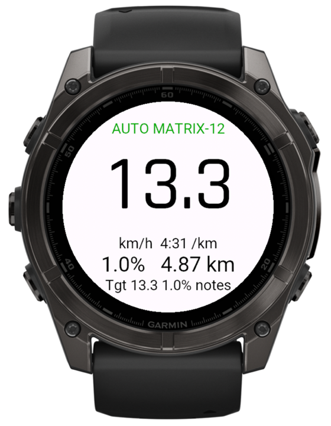

<p align="center">
  
</p>

<h1 align="center">FTMS Treadmill for Garmin</h1>

<p align="center">
  <a href="https://github.com/mladimatija/garmin-treadmill-ftms-field/actions/workflows/ci.yml"></a>
  <a href="https://github.com/mladimatija/garmin-treadmill-ftms-field/releases/latest"></a>
  <a href="https://github.com/mladimatija/garmin-treadmill-ftms-field/releases"></a>
  <a href="#supported-watches"></a>
  <a href="LICENSE.md"></a>
</p>

<p align="center">
  <a href="https://github.com/mladimatija/garmin-treadmill-ftms-field/releases/latest"></a>
</p>

<p align="center">
  <br>
  <sub>fēnix 8 in the Connect IQ simulator, with sample values</sub>
</p>

A Connect IQ data field that connects a Garmin watch to a Bluetooth FTMS treadmill and:

- **shows the treadmill's data live:** belt speed or pace, incline, distance;
- **records it in the activity:** treadmill speed, incline and target speed charts, per-lap
  distance / speed / climb / incline, and session totals, as developer fields in Garmin Connect;
- **drives the treadmill from your Garmin workout:** at every step it sets the belt speed and
  incline, taken from the step notes (`Treadmill 13.3 km/h, 1% incline`) or, without a note, from
  the middle of the step's pace target (4:28–4:34 /km → 13.3 km/h).

It works with any treadmill that implements the Bluetooth Fitness Machine Service (FTMS, 0x1826).
It was written for Matrix treadmills with the Touch console.

## Contents

- [Install](#install)
- [Supported watches](#supported-watches)
- [Settings](#settings)
- [Using it](#using-it)
- [Safety](#safety)
- [Trying it on a new treadmill](#trying-it-on-a-new-treadmill)
- [Troubleshooting](#troubleshooting)
- [Building from source](#building-from-source)
- [Development](#development)
- [Releasing](#releasing)
- [Known limitations](#known-limitations)
- [Disclaimer](#disclaimer)
- [License](#license)

## Install

1. Download `FtmsTreadmill-<version>.zip` from the
   [latest release](https://github.com/mladimatija/garmin-treadmill-ftms-field/releases/latest).
2. Find your watch's device id under [Supported watches](#supported-watches) and take
   `FtmsTreadmill-<device id>.prg` from the zip. A build only runs on the watch it was made for.
3. Connect the watch with its charging cable and copy the file into `GARMIN/Apps/`. Most recent
   watches appear as a media (MTP) device rather than a drive: on Windows open it in Explorer, on
   macOS use [OpenMTP](https://openmtp.ganeshrvel.com/) or Android File Transfer, and copy to
   `Internal Storage/GARMIN/Apps/`. Unplug the watch.
4. Add the field to the **Treadmill** activity. On a fēnix 7: **START → Treadmill**, hold **MENU →
   Treadmill Settings → Data Screens → Add New** (or pick a screen) **→ Layout**, choose the 1-field
   layout for the full view (2 fields still shows speed, incline and distance), select the field
   **→ Connect IQ → FTMS Treadmill**. Other watches have the same items under the activity's settings.

A sideloaded field can't be configured from the Garmin Connect app. The defaults are meant to work
as they are; to change one, edit it in `resources/settings/properties.xml` and
[build the field yourself](#building-from-source).

## Supported watches

Garmin watches whose firmware gives data fields Bluetooth Low Energy (`Toybox.BluetoothLowEnergy`)
and the current workout step (`Activity.getCurrentWorkoutStep()`, Connect IQ 3.2), with at least
64 KB of memory for data fields.

<details>
<summary>93 device ids (click to expand)</summary>

<!-- generated from the device files: keep in sync with manifest.xml -->
| Watch | Device id |
|---|---|
| Approach S50 | `approachs50` |
| Approach S70 42mm | `approachs7042mm` |
| Approach S70 47mm | `approachs7047mm` |
| Approach S72 43mm | `approachs7243mm` |
| Approach S72 47mm | `approachs7247mm` |
| D2 Air X10 | `d2airx10` |
| D2 Mach 1 | `d2mach1` |
| D2 Mach 2 | `d2mach2` |
| D2 Mach 2 Pro | `d2mach2pro` |
| Descent G2 | `descentg2` |
| Descent Mk2 / Mk2i | `descentmk2` |
| Descent Mk2 S | `descentmk2s` |
| Descent Mk3 43mm / Mk3i 43mm | `descentmk343mm` |
| Descent Mk3i 51mm | `descentmk351mm` |
| Enduro 3 | `enduro3` |
| Enduro 4 | `enduro4` |
| epix (Gen 2) / quatix 7 Sapphire | `epix2` |
| epix Pro (Gen 2) 42mm | `epix2pro42mm` |
| epix Pro (Gen 2) 47mm / quatix 7 Pro | `epix2pro47mm` |
| epix Pro (Gen 2) 51mm / D2 Mach 1 Pro / tactix 7, AMOLED Edition | `epix2pro51mm` |
| fēnix 5 Plus | `fenix5plus` |
| fēnix 5S Plus | `fenix5splus` |
| fēnix 5X Plus | `fenix5xplus` |
| fēnix 6 Pro / 6 Sapphire / 6 Pro Solar / 6 Pro Dual Power / quatix 6 | `fenix6pro` |
| fēnix 6S Pro / 6S Sapphire / 6S Pro Solar / 6S Pro Dual Power | `fenix6spro` |
| fēnix 6X Pro / 6X Sapphire / 6X Pro Solar / tactix Delta Sapphire / Delta Solar / Delta Solar, Ballistics Edition / quatix 6X / 6X Solar / 6X Dual Power | `fenix6xpro` |
| fēnix 7 / quatix 7 | `fenix7` |
| fēnix 7S | `fenix7s` |
| fēnix 7X / tactix 7 / quatix 7X Solar / Enduro 2 | `fenix7x` |
| fēnix 7 Pro | `fenix7pro` |
| fēnix 7S Pro | `fenix7spro` |
| fēnix 7X Pro | `fenix7xpro` |
| fēnix 7 Pro, Solar Edition (no Wi-Fi) | `fenix7pronowifi` |
| fēnix 7X Pro, Solar Edition (no Wi-Fi) | `fenix7xpronowifi` |
| fēnix 8 43mm | `fenix843mm` |
| fēnix 8 47mm / 51mm / tactix 8 47mm / 51mm / quatix 8 47mm / 51mm | `fenix847mm` |
| fēnix 8 Pro 47mm / 51mm / MicroLED / quatix 8 Pro 47mm / 51mm | `fenix8pro47mm` |
| fēnix 8 Solar 47mm | `fenix8solar47mm` |
| fēnix 8 Solar 51mm / tactix 8 Solar 51mm | `fenix8solar51mm` |
| fēnix 9 43mm | `fenix943mm` |
| fēnix 9 47mm / 51mm | `fenix947mm` |
| fēnix 9 Pro 43mm | `fenix9pro43mm` |
| fēnix 9 Pro 47mm | `fenix9pro47mm` |
| fēnix 9 Pro 51mm | `fenix9pro51mm` |
| fēnix 9 Pro Solar 47mm | `fenix9prosolar47mm` |
| fēnix 9 Pro Solar 51mm | `fenix9prosolar51mm` |
| fēnix E | `fenixe` |
| Forerunner 70 | `fr70` |
| Forerunner 165 | `fr165` |
| Forerunner 165 Music | `fr165m` |
| Forerunner 170 | `fr170` |
| Forerunner 170 Music | `fr170m` |
| Forerunner 245 Music | `fr245m` |
| Forerunner 255 | `fr255` |
| Forerunner 255 Music | `fr255m` |
| Forerunner 255s | `fr255s` |
| Forerunner 255s Music | `fr255sm` |
| Forerunner 265 | `fr265` |
| Forerunner 265s | `fr265s` |
| Forerunner 570 42mm | `fr57042mm` |
| Forerunner 570 47mm | `fr57047mm` |
| Forerunner 645 Music | `fr645m` |
| Forerunner 745 | `fr745` |
| Forerunner 945 | `fr945` |
| Forerunner 945 LTE | `fr945lte` |
| Forerunner 955 / Solar | `fr955` |
| Forerunner 965 | `fr965` |
| Forerunner 970 | `fr970` |
| Instinct 3 AMOLED 45mm | `instinct3amoled45mm` |
| Instinct 3 AMOLED 50mm | `instinct3amoled50mm` |
| Instinct Crossover AMOLED | `instinctcrossoveramoled` |
| MARQ Adventurer | `marqadventurer` |
| MARQ Athlete | `marqathlete` |
| MARQ Aviator | `marqaviator` |
| MARQ Captain / MARQ Captain: American Magic Edition | `marqcaptain` |
| MARQ Commander | `marqcommander` |
| MARQ Driver | `marqdriver` |
| MARQ Expedition | `marqexpedition` |
| MARQ Golfer | `marqgolfer` |
| MARQ (Gen 2) Athlete / Adventurer / Captain / Golfer / Carbon Edition / Commander, Carbon Edition | `marq2` |
| MARQ (Gen 2) Aviator | `marq2aviator` |
| MARQ (Gen 3) Athlete / Adventurer / Aviator / Commander / Golfer / Diver | `marq3` |
| Venu 2 | `venu2` |
| Venu 2S | `venu2s` |
| Venu 2 Plus | `venu2plus` |
| Venu 3 | `venu3` |
| Venu 3S | `venu3s` |
| Venu 4 41mm | `venu441mm` |
| Venu 4 45mm / D2 Air X15 | `venu445mm` |
| Venu Sq 2 Music | `venusq2m` |
| Venu X1 | `venux1` |
| vívoactive 5 | `vivoactive5` |
| vívoactive 6 | `vivoactive6` |

</details>

Not supported:

- **Watches with only 32 KB of memory for data fields**, where the field does not fit: fēnix 6 / 6S
  (non-Pro), Forerunner 55 / 245, Instinct 2 / 2S / 2X / 3 Solar / Crossover / E, Venu, Venu Sq,
  vívoactive 3 Music / 4 / 4S, Descent G1, Enduro (2021), D2 Air.
- **Watches whose firmware stops at Connect IQ 3.1** (no Bluetooth API for apps): fēnix 5 / 5X,
  Forerunner 645 / 935, D2 Delta, Descent Mk1, Approach S62 and older.
- **Venu Sq 2** (the non-Music model): its firmware has no Bluetooth API for apps.
- **Edge bike computers**: they have the APIs, but no treadmill activity.

## Settings

| Setting | Default | What it does |
|---|---|---|
| Control speed and incline from the workout | On | Off = read-only, never sends a command |
| Read "km/h" and "% incline" from step notes | On | e.g. `Treadmill 12.0 km/h, 1% incline`, `12,5 kph @ 2 %`, `7.5 mph` |
| Otherwise use the middle of the pace target | On | 4:55–5:05 → 12.0, 4:28–4:34 → 13.3, 5:50–6:10 → 10.0 km/h |
| Incline when a step gives none | 1.0 % | Only for steps that set a speed. −1 = leave the incline as it is |
| Never set speed above | 16 km/h | Hard limit on every command |
| Never set incline above | 8 % | Hard limit on every command |
| After I change the console, take over again at the next step | On | Off = one console change ends automatic control for the rest of the workout |
| Start the belt from the watch Start button | **Off** | See [Safety](#safety) |
| Pausing the watch pauses the belt | Off | |
| Big number | Speed | Speed (km/h) or pace (min/km) |
| Only treadmills whose name contains | empty | Empty = connect to the closest treadmill |
| Ignore treadmills weaker than | −90 dBm | Raise (e.g. −65) if it picks up the neighbouring treadmill |
| Treadmill works in mph | Off | Only for consoles that report mph over FTMS |
| Record treadmill data in the activity | On | Developer fields in the FIT file |

## Using it

1. Stand on the treadmill, clip on the safety key, start the belt from the console and walk at an
   easy speed. The console's Bluetooth must be on; on consoles with an "apps / Bluetooth connection"
   setting, enable it. **Matrix consoles: open the console's Bluetooth device-pairing screen
   ("Pair device", デバイスのペアリング on Japanese consoles) and leave it open until the field shows the
   belt speed.** The console only announces itself over Bluetooth while that screen is showing.
   Its "machine name" (マシン名) is the console's serial number, starting with `CTM`, but the watch
   can't see it (see `Checking` under [The screen](#the-screen)), so the field calls it just
   "Treadmill". Finding it can take a minute or two.
2. On the watch, start a Treadmill activity with a workout (fēnix: **START → Treadmill**, hold
   **MENU → Training → Workouts →** your workout **→ Do Workout**) and scroll to the field. Within a
   few seconds it shows `Searching...` → `Connecting` → the treadmill's name. It connects to the
   treadmill with the strongest signal, which is the one you are standing on.
3. Press **Start** on the watch. The field sets the first step's speed and incline and the belt
   ramps up.
4. Every new step (time-based, or when you press Lap) sets the new speed and incline.
5. Change speed or incline on the console at any time: the status turns **MANUAL** and the field
   leaves the belt alone until the next step. Auto Lap is not a new step, so it doesn't undo your change.
6. Stop as usual, with the console's Stop button or the safety key. The field never restarts a belt
   you stopped.
7. When you save the run, the watch offers **Calibrate & Save**: enter the treadmill distance shown
   on the field. The watch's own distance comes from the wrist and an app can't replace it.

### The screen

```
  AUTO MATRIX-12        status (see below) and treadmill name
      13.3              belt speed (or pace)
  km/h  4:31 /km
  1.0%     2.35 km      incline, treadmill distance since you pressed Start
  Tgt 13.3 1.0% notes   what the current step asks for, and where it came from (notes / pace)
```

| Status | Meaning |
|---|---|
| `Starting BLE`, `Searching...`, `Found 5` | Looking for treadmills |
| `No FTMS (6 seen)` + names below | After 10 s: the watch hears 6 Bluetooth devices, none of them a treadmill. The bottom line shows the two strongest with their signal, e.g. `iPhone -58  AirPods -70` |
| `No BLE devices` | After 10 s: the watch hears nothing at all (watch Bluetooth off?) |
| `16 unnamed -48 -55` (bottom line) | The watch hears 16 devices but none of their names; the numbers are the two strongest signals in dBm |
| `Checking -58` | Garmin watches only read the first part of a Bluetooth announcement. Many consoles (Matrix included) put their name and the FTMS service in the second part (the scan response), which the watch never sees. So after 10 s the watch connects to the strongest nearby devices one by one (at most 6, signal −80 dBm or better) and keeps the first one that turns out to be a treadmill. A device that isn't one is skipped for the rest of the activity |
| `Move closer` | Treadmills found, but all weaker than the signal limit |
| `Connecting`, `Setting up`, `Reconnecting` | Setting up or restoring the link (it reconnects by itself) |
| `AUTO` (green) | Following the workout |
| `OPEN` | The current step has no speed target (e.g. a lap-button rest); the belt is left alone |
| `MANUAL` (orange) | You changed the console; automatic control resumes at the next step |
| `REFUSED` (orange) | The treadmill turned down this step's speed or incline; the bottom line says which |
| `READ ONLY` | The treadmill doesn't accept commands, or control is turned off in the settings |
| `NO CONTROL` (orange) | The treadmill refused control (another app connected?); retried at every new step |
| `SAFETY KEY` (red) | The safety key was pulled |
| `No data` | Connected, but the treadmill sends nothing |
| `BLE busy` | The watch has no free Bluetooth slot for apps |

## Safety

> [!WARNING]
> The field changes the speed and incline of a moving treadmill. Use it at your own risk: keep the
> safety key clipped on, stay alert, and be ready to stop the belt from the console at any time.
> See the [disclaimer](#disclaimer).

The field is built to stay out of the way:

- Commands are only sent while the **watch timer is running and the belt is already moving**.
- The belt is **never started from the watch** unless you turn that setting on, and even then only
  within 10 seconds of pressing Start/Resume on the watch, never later (e.g. after reconnecting).
- Speed and incline are always clamped to your limits and to the machine's range.
- Any change on the console is a manual override. The console's Stop button and the safety key always win.
- While the watch is paused nothing is sent. Console changes made while paused are not overrides,
  and Resume brings the belt back to the current step.
- If the belt stops (safety key, Stop) and you restart it from the console while the watch timer is
  still running, the field brings it back to the current step's speed. Pause the watch first if you
  don't want that.
- When the workout ends, the field stops controlling and leaves the belt where it is.
- Closing the activity disconnects, so the treadmill is free for the next person.

## Trying it on a new treadmill

Create a short workout in Garmin Connect with three 1-minute steps, notes
`Treadmill 4.0 km/h, 0% incline`, `Treadmill 5.0 km/h, 1% incline`, `Treadmill 4.0 km/h, 0% incline`,
and pace targets 15:00, 12:00 and 15:00 /km as a fallback. Send it to the watch. The watch may beep
pace alerts, because wrist pace on a treadmill isn't exact; ignore them.

1. **Reading:** start the belt at walking speed and open the field. It should show the treadmill's
   name and the same speed and incline as the console, and follow console changes within 1–2 s.
2. **Control:** start the workout and press Start on the watch. The belt should go 4.0 → 5.0 / 1 % →
   4.0 / 0 %. The end of the bottom line shows `notes` if the watch passes step notes to the field,
   or `pace` if it doesn't (then speeds come from the pace targets and every step gets the default incline).
3. **Override:** during a step, press + on the console → `MANUAL`; the next step → `AUTO` again.
4. **Stop:** pull the safety key → `SAFETY KEY`; the belt stops and nothing restarts it.
5. **Recording:** save the activity and open it in Garmin Connect: there should be *Treadmill speed /
   incline / Target speed* charts and a *Treadmill distance* summary.

If reading works but control shows `READ ONLY` or `NO CONTROL`, the console only shares its data over
Bluetooth: live data and recording still work, and you set the speed by hand from the target line.

Whatever the result, a [treadmill report](https://github.com/mladimatija/garmin-treadmill-ftms-field/issues/new?template=treadmill_report.yml) helps
the next person with the same machine.

## Troubleshooting

| Problem | Try |
|---|---|
| `No FTMS (n seen)`, treadmill not in the names | The console isn't announcing itself: its Bluetooth or app connection is off or, on Matrix consoles, the device-pairing screen isn't open (see [Using it](#using-it)). Also check that no other phone or app is connected to it (FTMS allows one). |
| Treadmill name shows in the bottom line but it never connects | Check with **nRF Connect** (phone app, *Scanner*): your treadmill should list *Services: Fitness Machine*. Don't tap *Connect* there, and close the app afterwards, or it holds the treadmill's one connection. |
| `No BLE devices` | Restart the watch, and make sure its Bluetooth (phone connection) isn't switched off. |
| Connects to the wrong treadmill | Raise the signal limit to −65 dBm so only the console you're standing at qualifies. *Only treadmills whose name contains* works only for consoles whose name the watch can see: Matrix consoles hide theirs, and with a name filter set the watch doesn't try unnamed devices at all. |
| Stays on `No FTMS (n seen)` after several `Checking` tries | It tried the six strongest devices and none was a treadmill. Make sure the console's pairing screen is open and nothing else is connected to it, then stop and restart the activity to search again. |
| `BLE busy` | Too many Bluetooth sensors or apps on the watch; remove another Connect IQ Bluetooth field from the screen. |
| Speed is off by a factor of 1.6 | Turn on *Treadmill works in mph*. |
| `REFUSED` with `Speed Refused` / `Incline Refused` | Some consoles want an FTMS start first; the field already sends one per step while the belt is moving. If the console still refuses, set that value by hand. |
| The field shows `IQ!` | The field crashed. Please [open an issue](https://github.com/mladimatija/garmin-treadmill-ftms-field/issues) with `GARMIN/APPS/LOGS/CIQ_LOG.YML` from the watch. |

## Building from source

You need:

- the [Connect IQ SDK](https://developer.garmin.com/connect-iq/sdk/), installed with the SDK Manager
  (on macOS also `brew install --cask connectiq connectiq-sdk-manager`), and `monkeyc` on the PATH;
- the device files of the watches you build for, downloaded in the SDK Manager;
- Java 8 or newer;
- a developer key, created once with **Monkey C: Generate a Developer Key** in VS Code, or:

  ```sh
  openssl genrsa -out developer_key.pem 4096
  openssl pkcs8 -topk8 -inform PEM -outform DER -in developer_key.pem -out ~/developer_key.der -nocrypt
  rm developer_key.pem
  ```

Then:

```sh
./build.sh                  # every watch → bin/FtmsTreadmill-<device id>.prg
./build.sh fenix7x fr965    # only these watches
```

`DEVELOPER_KEY=/path/to/key.der` uses another key and `JOBS=8` builds more watches in parallel.

In VS Code with the Monkey C extension, **Monkey C: Build for Device** works too. Leave the
extension's *Type Check Level* on **Default**: `monkey.jungle` turns type checking off because the
code is untyped.

**Monkey C: Run in Simulator** is useful to check the layout. The simulator only talks Bluetooth
through a Nordic nRF52 USB dongle, so connecting to a treadmill needs a real watch.

## Development

```sh
python3 -m unittest discover -s tests -v
```

The FTMS packet handling, target parsing and the Bluetooth and workout state machines are pure
logic, so `tests/` carries a Python port of them that runs without a watch or the SDK. It is kept
line-for-line close to the Monkey C, so change both together. `tests/sim.py` adds a fake Connect IQ
Bluetooth stack, simulated treadmills with different quirks and a watch running a workout, so whole
sessions can be tested.

| File | Role |
|---|---|
| `source/FtmsTreadmillApp.mc` | App entry: settings, Bluetooth delegate, view |
| `source/FtmsManager.mc` | Bluetooth: profile, scan, connect, discovery, the GATT queue, Control Point (request control, retries, timeouts), machine status |
| `source/Ftms.mc` | FTMS packet decoding and encoding (Treadmill Data 0x2ACD, Feature 0x2ACC, ranges 0x2AD4 / 0x2AD5, Control Point 0x2AD9, Status 0x2ADA) |
| `source/WorkoutFollower.mc` | Reads the current workout step, sends targets, detects console overrides, applies the safety rules |
| `source/Targets.mc` | Step notes and pace targets → km/h and %, clamping, pace formatting |
| `source/TreadmillState.mc` | Live values and the distance / climb / averages accumulated while the timer runs |
| `source/FitRecorder.mc` | Developer fields written to the activity |
| `source/TreadmillView.mc` | Drawing for any field size, timer and lap events |

Connect IQ data fields have no timers, so everything is driven by `compute()` (once a second) and the
Bluetooth callbacks. Only one GATT request may be outstanding at a time, so reads, notification
set-ups and commands all go through one queue. If the watch refuses the full six-characteristic
profile, the field retries with a smaller one (data + control + status, then data only).

## Releasing

Pushing a tag `vX.Y.Z` runs [`release.yml`](.github/workflows/release.yml). It runs the tests, builds
every watch in `manifest.xml` and publishes a GitHub release with all builds in one zip and its
SHA-256. The tag must match the `version` in `manifest.xml`:

```sh
# bump version="X.Y.Z" in manifest.xml, commit, then
git tag vX.Y.Z
git push origin vX.Y.Z
```

The workflow needs these repository secrets:

| Secret | Value |
|---|---|
| `CONNECTIQ_DEVELOPER_KEY` | The developer key, base64-encoded: `base64 -i ~/developer_key.der` |
| `GARMIN_USERNAME`, `GARMIN_PASSWORD` | A Garmin account to download the SDK and device files. It must not use two-step verification. |

The SDK version and the accepted SDK licence agreement are pinned at the top of the workflow. When
Garmin changes the agreement, the build stops until the new hash is put there.

## Known limitations

- Whether a console accepts speed and incline commands over FTMS, not just sharing its data, can only
  be found out on the machine. The field detects it and falls back to read-only.
- A data field only sees the current workout step, and can't change the watch's own distance or pace.

## Disclaimer

You use this field entirely at your own risk. It is provided as is, without warranty of any kind,
and the author is not responsible for any injury, damage to treadmills, watches or other property,
or any other loss arising from its use, as also set out in the [license](LICENSE.md). Follow the
treadmill maker's safety instructions and your gym's rules, and check that you may connect your
own devices to the gym's machines.

This is an independent project, not affiliated with or endorsed by Garmin or Matrix Fitness.
Garmin, Connect IQ and the watch names are trademarks of Garmin Ltd. or its subsidiaries; other
product names are trademarks of their respective owners.

## License

[PolyForm Noncommercial 1.0.0](LICENSE.md): free for personal and other noncommercial use, provided
the copyright notice is kept. Commercial use is not permitted.
